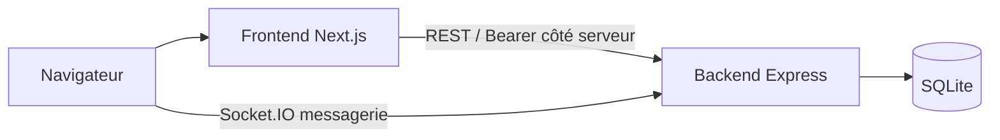

# Kasa

Kasa est une application de location immobilière composée d’un frontend Next.js et d’une API Express avec SQLite. Les visiteurs consultent les logements ; les comptes connectés peuvent gérer leurs favoris et utiliser la messagerie. Les rôles `owner` et `admin` disposent des parcours de gestion prévus par l’application.

## Architecture



- `frontend/` : routes et rendu avec l’App Router, composants partagés, fonctionnalités métier, appels à l’API et tests Vitest.
- `backend/` : API REST, authentification et autorisation, services métier, base SQLite et serveur Socket.IO pour la messagerie.
- `backend/public/openapi.json` : contrat détaillé de l’API REST ; `backend/public/docs.html` fournit son interface de consultation.

Le frontend utilise des Server Components par défaut. Les appels qui nécessitent la session sont effectués côté serveur avec le cookie HttpOnly et un bearer token ; le navigateur ne reçoit pas le token de session. Les données privées sont récupérées sans cache partagé. Les pages interactives utilisent des Client Components à la frontière nécessaire.

## Prérequis

- Node.js 20.9 ou plus récent (version minimale requise par Next.js 16).
- Yarn Classic 1.22 pour le frontend.
- npm pour le backend.

## Installation

```sh
cd frontend && yarn install
cd ../backend && npm install
```

## Configuration

Copiez `backend/.env.example` vers `backend/.env`, puis adaptez les valeurs locales. Configurez `JWT_SECRET` et `MESSAGING_SOCKET_SECRET` avec des secrets distincts avant tout déploiement ; ne les ajoutez jamais au dépôt.

Le frontend lit les variables décrites dans `frontend/.env.example` :

- `API_BASE_URL` : origine de l’API Express, par exemple `http://localhost:3001`.
- `NEXT_PUBLIC_MESSAGING_SOCKET_URL` : origine du serveur Express pour Socket.IO.
- `SITE_URL` : URL publique du frontend, utilisée pour les URL canoniques.

## Démarrage local

Dans deux terminaux depuis la racine du dépôt :

```sh
npm --prefix backend start
yarn --cwd frontend dev
```

Le backend écoute par défaut sur `http://localhost:3001` selon `backend/.env.example`; le frontend est servi sur `http://localhost:3000`. Consultez l’interface API à `http://localhost:3001/docs.html`.

## Tests et vérifications

```sh
yarn --cwd frontend test
yarn --cwd frontend lint
yarn --cwd frontend build
cd backend && node --test
```

Voir [frontend/README.md](frontend/README.md) pour les conventions et commandes frontend, et [backend/README.md](backend/README.md) pour la configuration, la base de données et l’API.

La documentation du code générée par JSDoc et TypeDoc est indexée dans [docs/README.md](docs/README.md).
